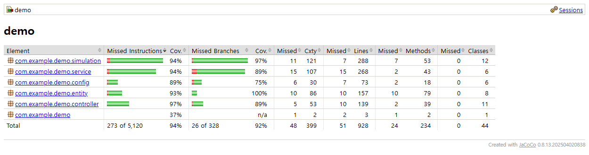
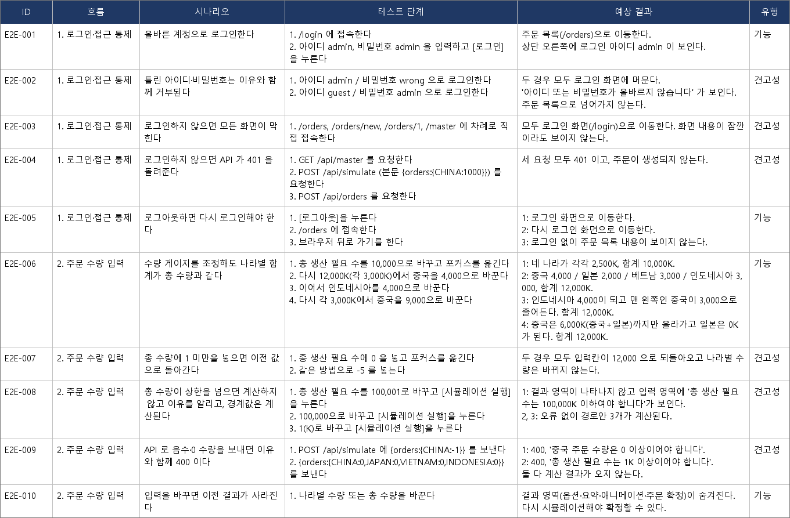

# 1. 테스트 세팅

| 테스트 | 개수 | 테스트 도구 |
|---|:-:|---|
| Unit Test | 26개 | JUnit 5 |
| Slice Test | 40개 | JUnit 5 + Spring Boot Test (`@WebMvcTest`, `@DataJpaTest`) |
| 통합 테스트 | 49개 | JUnit 5 + Spring Boot Test (`@SpringBootTest`) |
| E2E 테스트 | 87개 | Playwright |
| Robustness 테스트 | 1개 | JUnit 5 |
| Stress 테스트 | 0개 | - |
| 성능 테스트 | 6개 | JUnit 5 (시간 측정) |
| Test Coverage | 라인 94.5% (분기 92.1%) | JaCoCo |

- JUnit 122건과 E2E 87건이 모두 통과합니다.
- E2E 중 1건은 알려진 결함(없는 주문 번호로 접속하면 오류 화면이 뜸)이라 "실패해야 통과"로 표시했습니다.

 

## 테스트별 대상과 이유

| 종류 | 무엇을 확인하나 | 왜 필요한가 |
|---|---|---|
| Unit | 경로 계산, 마스터 입력값 변환, 요청 횟수 제한, 납기 초과 일수 | 계산과 규칙이 맞는지 가장 빠르게 확인 |
| Slice | 새로 만든 기능 4개의 요청·응답과 DB 컬럼 (아래 설명) | 규칙은 빼고 입구와 출구의 문제만 따로 확인 |
| 통합 | 주문 확정·상태 변경, 고객사, 납기일, 가입·로그인, 공장 운영비 | 서비스와 DB가 함께 규칙대로 동작하는지 확인 |
| Robustness | 배 1~4척 × 주문 조합 전체 | 어떤 조합에서도 "가장 빠른 안이 더 느리지 않다" 같은 계산 규칙이 깨지지 않는지 확인 |
| 성능 | 경로 계산, 시뮬레이션 요청, 동시 요청(사용자 8명), 주문 1,000건 목록 조회 | 코드를 바꿨을 때 응답이 눈에 띄게 느려지는 것을 잡기 위해 (한도는 여유 있게 설정) |
| E2E | 로그인, 주문, 확정, 마스터 수정 등 사용자가 화면에서 하는 흐름 | 실제 화면에서 처음부터 끝까지 되는지 확인 |

 

## Slice Test: 새로 만든 기능 4개만 대상

기존 화면과 계산 전체가 아니라, **이번에 추가한 기능 4개**를 대상으로 작성했습니다.

- 입구: 화면이 보내는 요청과 서버의 응답 (로그인 확인, 값 변환, 오류 응답)
- 출구: 새로 만든 DB 컬럼에 값이 저장되고 다시 읽히는지
- 서비스 규칙은 가짜로 바꿔 두어서, 문제가 생기면 입구와 출구 중 어디인지 바로 알 수 있습니다.

| 기능 | 개수 | 확인하는 것 | 왜 필요한가 |
|---|:-:|---|---|
| 고객사 | 7개 | 로그인 없이는 수정 불가, 거부·충돌 응답, 작성자에게만 수정 가능 표시 | 남의 주문 고객사를 고칠 수 없다는 규칙이 요청 단계에서 지켜지는지 |
| 필요 납기일 | 14개 | 정수만 받기(5.5나 문자는 거부), 생략하면 "가능한 빨리", 납기 초과 일수 표시 | 잘못된 납기가 조용히 바뀌어 저장되지 않게 |
| 회원 가입 | 9개 | 로그인 없이 가입, 로그인 때 세션 교체, 가입 횟수 제한 | 누구나 접근하는 인증 입구라 위험이 큼 |
| 공장 운영비 | 4개 | 억 원 단위로 표시, 저장 요청 전달, 틀린 값은 이유를 모아 알림 | 입력 단위가 틀리면 비용 계산이 통째로 틀림 |
| DB 컬럼 (4개 기능 공통) | 6개 | 고객사·납기·가입 해시 설정·운영비가 저장되고 읽힘, 고객사 100자와 아이디 중복이 DB에서도 막힘 | 새 컬럼에 값이 그대로 저장되고 읽히는지 (비워 둔 값 포함) |

운영 코드를 일부러 망가뜨려 보았더니(고객사 이름 누락, 납기 실수 허용, 로그인 확인 제거 등 7가지) 모두 테스트가 실패해서, 테스트가 실제로 문제를 잡아냅니다.

 

## 테스트 커버리지

JUnit 122건을 실행하며 측정했습니다.

| 구분 | 커버 / 전체 | 비율 |
|---|:-:|:-:|
| 라인 | 877 / 928 | 94.5% |
| 분기 | 302 / 328 | 92.1% |

- 가장 높은 곳은 경로 계산 코드로, 라인 97.6%·분기 97.0%입니다.
- 낮은 곳은 요청 횟수 제한 일부(81%), 페이지 연결(82%), 앱 시작 코드입니다.
- JUnit 기준이며, E2E는 포함하지 않았습니다.

 

## 테스트 시나리오

E2E 시나리오 엑셀(`docs/e2e/e2e-test-scenarios-final.xlsx`) 42개(기능 26, 견고성 16) 중 앞 10개입니다. 이후 기능이 추가되며 E2E는 87건이 되었습니다.

---

[← 목차](README.md) · [다음: Loop 설계 →](02-loop.md)
