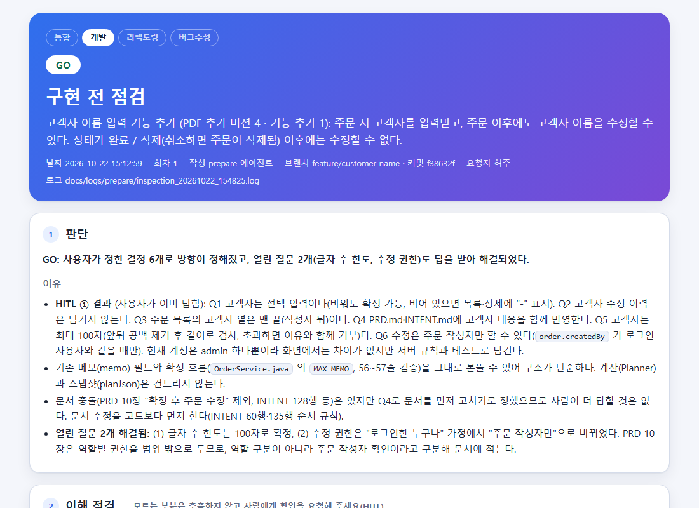
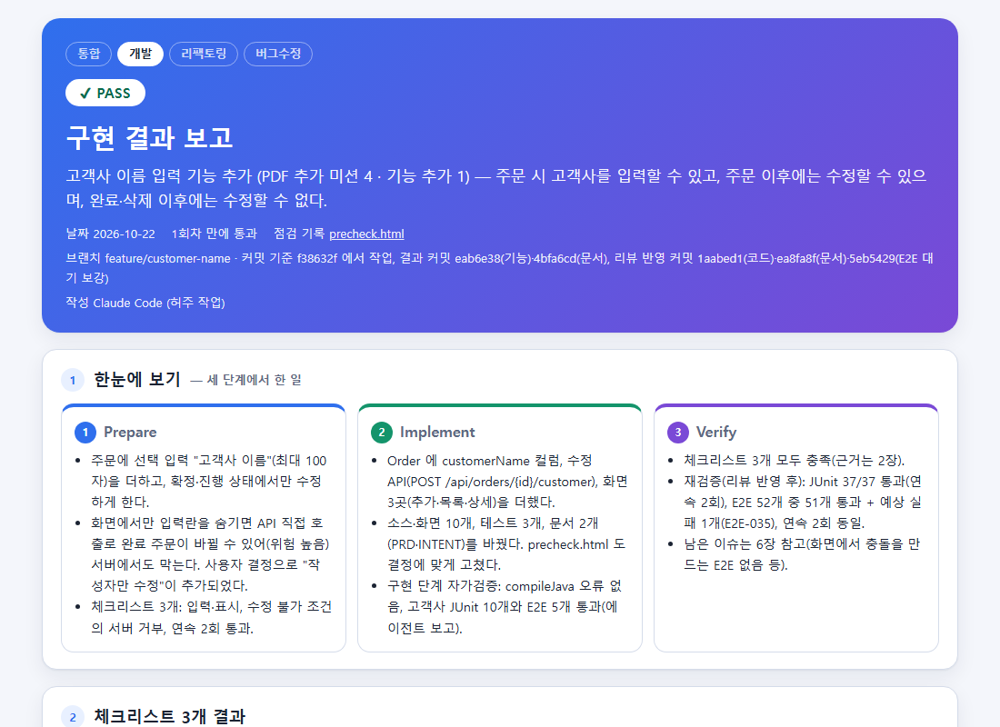

# 2. Loop 설계

Loop 설계는 이번 팀 프로젝트에서 가장 핵심이 되는 내용입니다.

이번 프로젝트에서는 구현 전에 점검하고, 구현 후에는 검증하여 리포트를 작성하는 자신만의 Loop를 각자 설계했습니다.

이 중 소개할 만한 좋은 Loop를 선정하여 소개합니다.

 

## 팀 Evidence 템플릿

팀에서 협의한 템플릿 2개입니다.

모든 Loop가 같은 틀로 구현 전·후 증거를 남깁니다.

| 템플릿 | 사용 시점 | 링크 |
|---|---|---|
| precheck.html | 구현 전 | [precheck.template.html](../docs/templates/precheck.template.html) |
| report.html | 구현 후 | [report.template.html](../docs/templates/report.template.html) |

고객사 이름 입력 기능에 실제로 쓴 화면입니다.

| precheck.html (구현 전 점검) | report.html (구현 결과 보고) |
|---|---|
|  |  |
| 원본: [precheck.html](../docs/evidence/허주/TASK-001-customer-name/precheck.html) | 원본: [report.html](../docs/evidence/허주/TASK-001-customer-name/report.html) |

 

## Best Practice: Loop 설계

팀 프로젝트 중 각자 자신만의 Loop를 소개한 Markdown 페이지를 업로드했습니다. (경로 : `docs/loops/팀원이름/README.md`)

이 중 괜찮다고 생각이 드는 Best Practice Loop를 소개합니다.

#### Best Practice 1

| 항목 | 내용 |
|---|---|
| 소개 팀원 | 정혜미 프로 ("전후 사진 비교" 리팩토링 Loop) |
| Loop 설명 링크 | [docs/loops/정혜미/README.md](../docs/loops/정혜미/README.md) |
| 좋았던 점 | · 구현 전에 "이 계획이 가능한가"(실현성 점검)와 "이득이 있는가"(효과 측정)를 먼저 따져 불필요한 수고를 줄임 · 정리 전·후의 계산 결과를 같은 방법으로 파일에 저장해 글자 단위로 비교하고, "동작이 그대로"임을 증거로 남김 · 첫 실행에서 겪은 실패(불가능한 계획 승인, 같은 실패 3회 반복)를 설계에 반영해 고침 |

#### Best Practice 2

| 항목 | 내용 |
|---|---|
| 소개 팀원 | 전예리 프로 (버그수정·기능개발 Loop) |
| Loop 설명 링크 | [docs/loops/yeri/README.md](../docs/loops/yeri/README.md) |
| 좋았던 점 | · 요청 유형(버그수정·기능개발)에 따라 점검과 검증을 달리함. 버그수정은 먼저 재현하고 원인을 확인, 기능개발은 구현 전에 사람이 계획을 승인 · 유형마다 **체크리스트 3개를 모두 통과하면 완료**로 보는 기준이 분명함 · 검증에 실패하면 점검 단계부터 다시 하고, 최대 3회차까지 시도해도 통과하지 못하면 멈춤 |

 

## Loop를 돌리며 느꼈던 점

#### 좋았던 점

- 단계마다 별도의 AI가 새로 시작해서, 앞 단계의 판단에 끌려가지 않고 따로 확인함
  - 예: 고객사 기능에서 점검 단계가 "확정된 주문은 수정하지 않는다"는 기존 규칙과 충돌한다는 것을 먼저 찾아냄
- 구현 전에 사람이 요구사항(선택 입력, 100자 제한, 작성자만 수정)을 먼저 정해서, 첫 시도에 검증을 통과함
- 구현 전 점검서와 구현 후 결과서가 남아, 리뷰어가 근거를 바로 확인할 수 있음

#### 아쉬웠던 점

- 처음에는 Loop 단계를 흉내만 내어 직접 진행했다가, Workflow로 처음부터 다시 진행함
- 로그 원본이 임시 폴더에만 있어서, 옮겨 적은 로그를 증거로 올려야 했음

#### 문제와 개선

| 문제 | 원인 | 어떻게 개선했나요? |
|---|---|---|
| 점검 결과에 "기존 규칙과 충돌 없음"이라고 잘못 씀 | 범위 밖으로 정한 항목을 문서에서 확인하지 않음 | 별도 점검 단계가 충돌을 찾아 바로잡고, 문서를 코드보다 먼저 고치도록 계획 |
| E2E 시험이 가끔 실패함 | 목록이 그려지기 전에 값을 읽음 | 응답을 일부러 늦춰 실패를 재현하고, 기다리는 코드를 추가해 40회 반복에서 모두 통과 |
| 구현이 막혔는데 같은 시도를 3번 반복함 (정혜미 프로) | 불가능한 계획을 승인했고, 이득도 재 보지 않음 | 구현 전에 "가능한가, 이득이 있는가"를 점검하고, 같은 실패가 2번 나오면 바로 사람에게 넘김 |

---

[← 이전: 테스트 세팅](01-test.md) · [목차](README.md) · [다음: 기능 추가 미션 동작 영상 →](03-missions.md)
