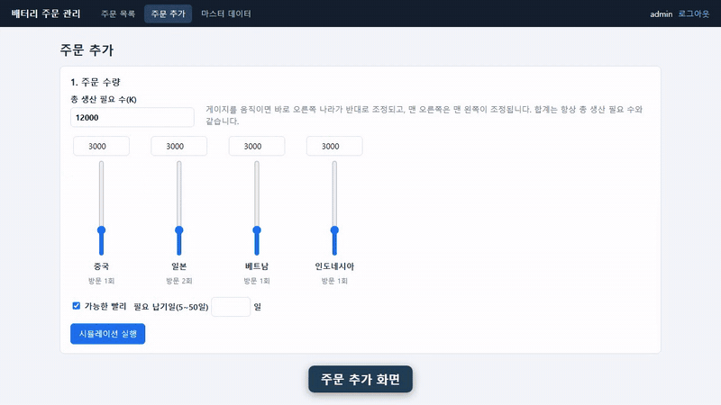
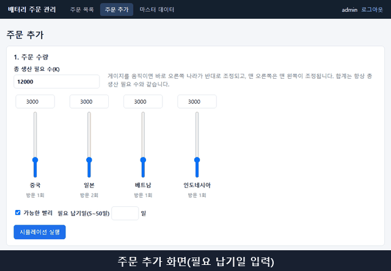
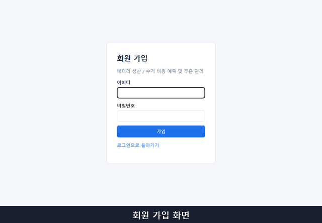
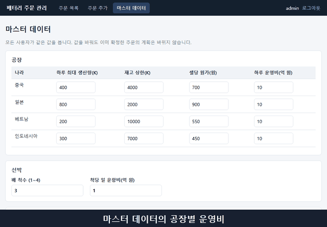

# 3. 기능 추가 미션 동작 영상

기능 추가를 한 결과 시연 영상을 살펴봅니다.

 

## 기능 1. 고객사 이름 입력

주문할 때 고객사 이름(선택, 최대 100자)을 입력하고, 주문 후에도 고칠 수 있습니다. 주문 작성자만 고칠 수 있고, 완료·삭제된 주문은 고칠 수 없습니다.

- 담당: 허주 프로

 

## 기능 2. 필요 납기일

주문 추가 화면에서 필요 납기일(5~50일) 또는 "가능한 빨리"를 정하면, 소요 일수가 납기를 넘는 안에 "납기 초과 N일"이 표시됩니다. "가능한 빨리"를 체크하면 적어 둔 납기일은 비워집니다. 주문을 확정하면 납기가 주문에 저장되어 목록과 상세에도 보입니다.

- 담당: 정혜미 프로

 

## 기능 3. 회원 가입

로그인 화면의 "회원 가입"으로 계정을 만들고, 그 계정으로 로그인해 주문 목록을 봅니다. 가입 회원은 admin과 같은 권한을 가집니다.

- 담당: 장영은 프로

 

## 기능 4. 공장 운영비

마스터 데이터에서 나라별 공장 운영비(억/일)를 정하면, 시뮬레이션이 공장 운영 일수에 곱해 비용에 반영합니다. 값을 바꾸면 총비용과 "총비용 최소" 안이 달라집니다.

- 담당: 전예리 프로

---

[← 이전: Loop 설계](02-loop.md) · [목차](README.md) · [다음: PR & 코드리뷰 →](04-review.md)
